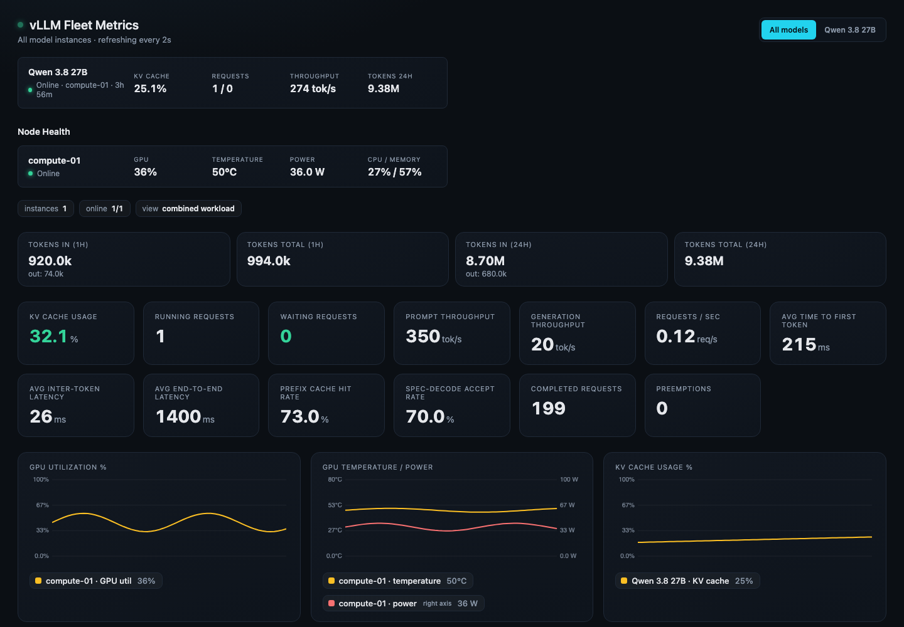
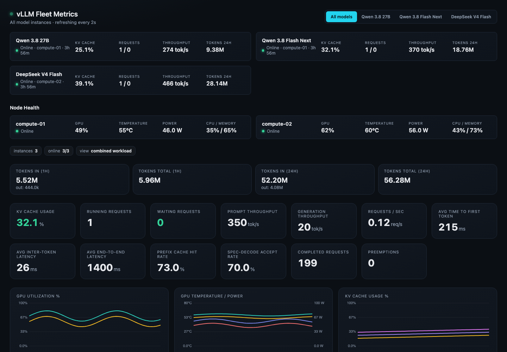

# vLLM Fleet Dashboard

vLLM Fleet Dashboard shows live metrics of [vLLM](https://github.com/vllm-project/vllm)
and TensorFold servers. It also shows GPU, CPU, memory, and network data of
the host. One Go binary monitors one node or a fleet of nodes.



## Features

- Live charts for throughput, latency, requests, KV cache, prefix cache, and
  speculative decoding.
- GPU data from `nvidia-smi` or `amd-smi`.
- Host data from `/proc` and sysfs.
- Automatic discovery of local vLLM and TensorFold servers.
- Fleet view of many nodes and models.
- Prometheus `/metrics` endpoint and a Grafana dashboard.
- 24 hours of history in memory.
- One binary with an embedded web UI.

## Requirements

- Linux on the compute nodes.
- A vLLM or TensorFold server with its `/metrics` endpoint.
- `nvidia-smi` or `amd-smi` for GPU data.

## Quick start

Start the dashboard on a node that runs vLLM. You do not need a configuration
file. The dashboard finds the local vLLM servers. It uses the host name as the
node name. Then open `http://localhost:9090`.

### Debian and Ubuntu (APT)

```sh
sudo install -d -m 0755 /etc/apt/keyrings
curl -fsSL https://awlx.github.io/vllm-dashboard/vllm-dashboard.gpg.key \
  | sudo gpg --dearmor -o /etc/apt/keyrings/vllm-dashboard.gpg
echo "deb [signed-by=/etc/apt/keyrings/vllm-dashboard.gpg] https://awlx.github.io/vllm-dashboard stable main" \
  | sudo tee /etc/apt/sources.list.d/vllm-dashboard.list
sudo apt update
sudo apt install vllm-dashboard
```

The service starts at once with the defaults. It listens on port 9090 on all
interfaces. To change the settings, create `/etc/vllm-dashboard/dashboard.json`
and restart the service. See [Deployment](docs/deployment.md#apt-package).

### Docker

```sh
docker run -d --name vllm-dashboard --read-only --cap-drop ALL \
  --gpus all --pid host --network host \
  ghcr.io/awlx/vllm-dashboard:latest
```

See [Containers](#containers) for the flags.

### Binary

Build the binary as shown in [Build from source](#build-from-source). Then
start it:

```sh
./vllm-dashboard
```

## Fleet mode

1. Start the dashboard on each compute node.
2. Start one more dashboard as the fleet collector.
3. Give the collector the URLs of the nodes.
4. Open only the collector UI.

```json
{
  "node": { "discover": false },
  "peers": ["http://192.0.2.10:9090", "http://192.0.2.11:9090"]
}
```

You can also set `VLLM_DASHBOARD_PEERS=http://192.0.2.10:9090,http://192.0.2.11:9090`.
Each node gives its name to the collector. The collector gets the data from
the nodes when you open a page. The nodes do not send data.



The dashboard has no authentication. Keep the nodes on a trusted network. Put
the collector behind a reverse proxy with TLS and authentication.

## Configuration

The configuration file is optional. Set its path in `VLLM_DASHBOARD_CONFIG`.
If the file does not exist, the dashboard uses the defaults. Environment
variables override the file.

| Key | Default | Auto-detected | Environment variable |
| --- | --- | --- | --- |
| `listen` | `:9090` | No | `VLLM_DASHBOARD_LISTEN` |
| `poll_interval` | `1s` (`500ms` to `10s`) | No | `VLLM_DASHBOARD_POLL_INTERVAL` |
| `node.key`, `node.name` | Short host name | Yes | `VLLM_DASHBOARD_HOSTNAME` |
| `node.hostname` | Full host name | Yes | `VLLM_DASHBOARD_HOSTNAME` |
| `node.discover` | `true` | No | `VLLM_DASHBOARD_DISCOVER` |
| `node.models` | Discovered servers | Yes | None |
| `peers` | None | No | `VLLM_DASHBOARD_PEERS` |

Add a model to `node.models` only if discovery cannot find it. A model needs
`port` or `metrics_url`. See [config.node.example.json](config.node.example.json)
and [config.example.json](config.example.json).

Use the same `poll_interval` on all nodes and on the collector. Old
configuration files still load. The dashboard ignores obsolete keys and logs
them.

See [Configuration and discovery](docs/architecture.md#configuration-and-discovery)
for all keys and the discovery rules.

## Prometheus and Grafana

`GET /metrics` gives Prometheus metrics for the local node and all peers. All
names start with `vllm_dashboard_`. In fleet mode, scrape only the collector.

Import [docs/grafana-dashboard.json](docs/grafana-dashboard.json) into Grafana.
Then select your Prometheus data source.

See [Prometheus `/metrics`](docs/architecture.md#prometheus-metrics) for all
metrics, labels, scrape layouts, and example queries.

## Containers

The image is `ghcr.io/awlx/vllm-dashboard`. It runs on `linux/amd64` and
`linux/arm64`. A node in a container needs these flags:

| Flag | Reason |
| --- | --- |
| `--gpus all` | GPU data. Needs the NVIDIA Container Toolkit. |
| `--pid host` | Discovery and vLLM process data. |
| `--network host` | Host network data and access to vLLM on `127.0.0.1`. |

These flags decrease the isolation of the container. Use them only on trusted
nodes. A collector does not need them. In a container, systemd service data
and the vLLM version are not available.

[docker-compose.example.yml](docker-compose.example.yml) has a collector and a
node service. See [docs/deployment.md](docs/deployment.md) for image tags, the
APT package, systemd, and security.

## Build from source

You need Go 1.26 or later.

```sh
git clone https://github.com/awlx/vllm-dashboard.git
cd vllm-dashboard
go test ./...
go vet ./...
CGO_ENABLED=0 go build -trimpath -ldflags="-s -w" -o vllm-dashboard ./cmd/vllm-dashboard
```

To build the container image, run `docker build -t vllm-dashboard .`.

See [docs/architecture.md](docs/architecture.md) for the code layout, the data
flow, and the HTTP API.

## License

[Apache License 2.0](LICENSE)
