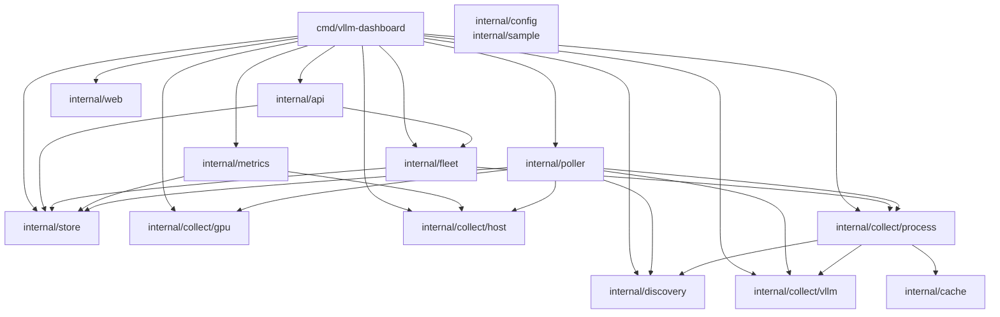
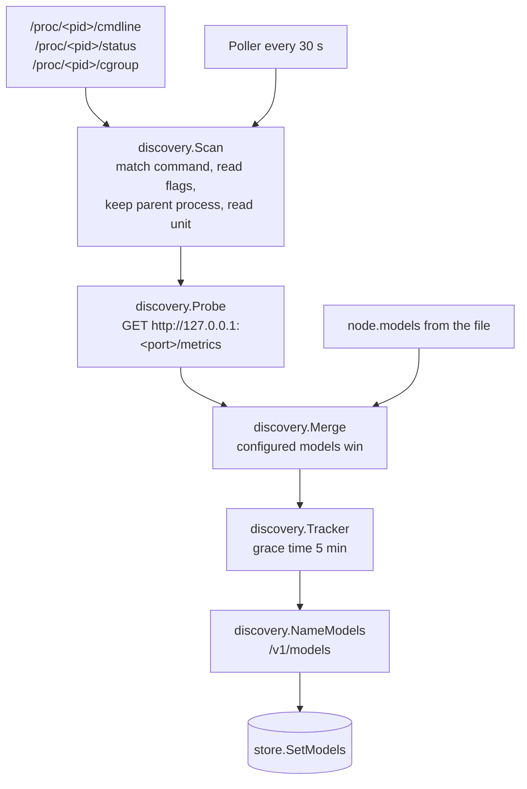
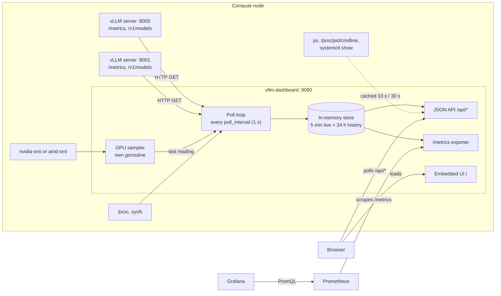
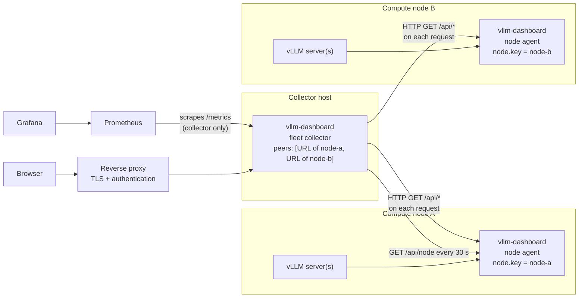
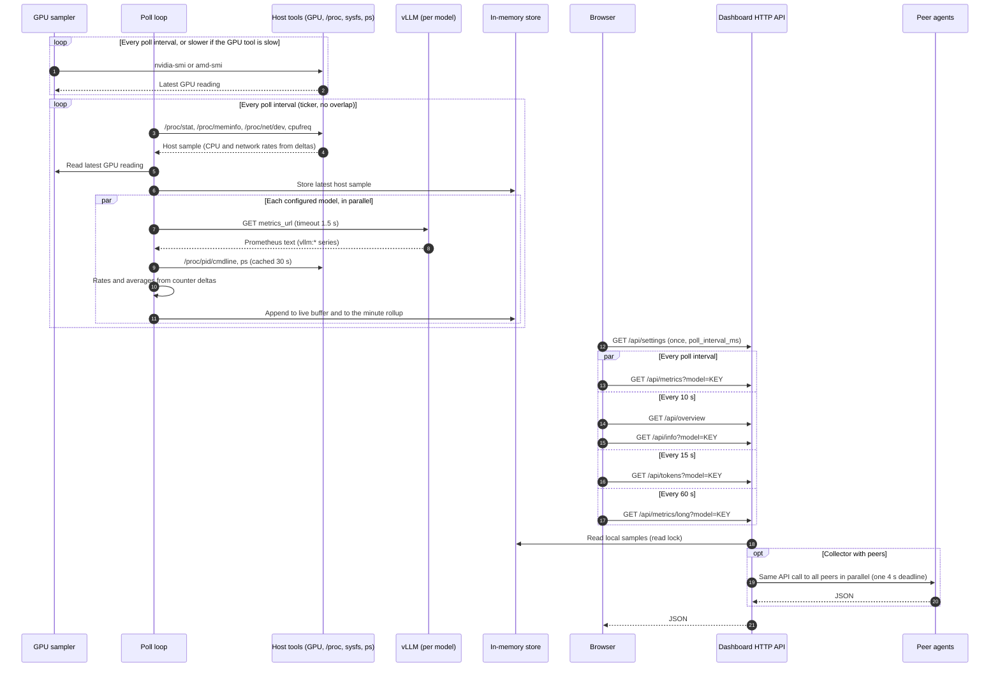
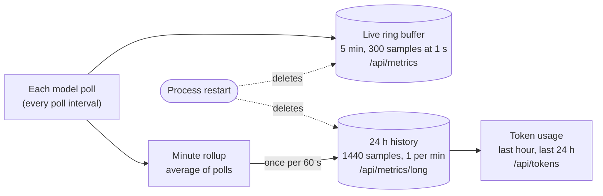
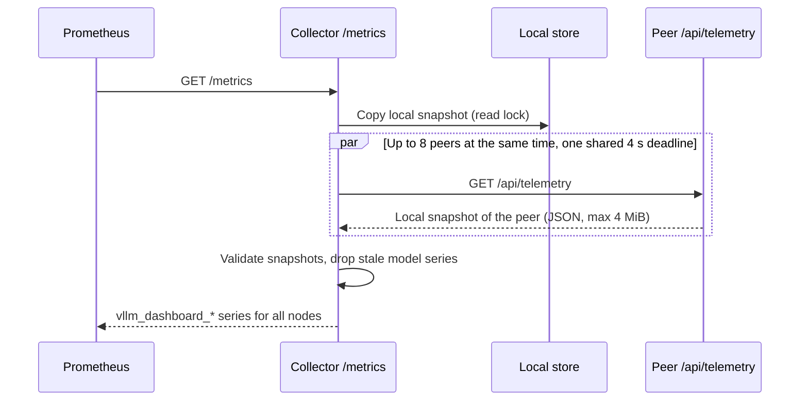

# Architecture

This document describes how the vLLM dashboard collects, stores, and serves
data. It covers the single-node and the multi-node (fleet) deployment, the
HTTP API, the Prometheus `/metrics` endpoint, data retention, the
configuration, and model discovery.

The dashboard is one Go binary. The same binary runs as a **node agent** (it
has local models) or as a **fleet collector** (it has `peers`). A process can
have both, but the usual fleet layout gives the collector no local models.

## Contents

- [Components](#components)
- [Configuration and discovery](#configuration-and-discovery)
- [Single-node deployment](#single-node-deployment)
- [Multi-node (fleet) deployment](#multi-node-fleet-deployment)
- [Poll cycle and browser refresh](#poll-cycle-and-browser-refresh)
- [Data retention](#data-retention)
- [Data scraped from vLLM](#data-scraped-from-vllm)
- [HTTP API](#http-api)
- [Prometheus `/metrics`](#prometheus-metrics)
- [Grafana](#grafana)

## Components

The code uses the standard Go layout. `cmd/vllm-dashboard` is a small entry
point. All other code is in packages under `internal/`. Tests are next to the
code that they test.

Build the binary with:

```sh
CGO_ENABLED=0 go build -trimpath -ldflags="-s -w" -o vllm-dashboard ./cmd/vllm-dashboard
```

| Component | Package | Main identifiers | Purpose |
| --- | --- | --- | --- |
| Entry point | `cmd/vllm-dashboard` | `main` | Loads the configuration, runs the first model discovery, reads the vLLM and kernel versions, starts the GPU sampler, the poller, and the peer resolver, registers the handlers on one `http.ServeMux`, and serves HTTP. |
| Configuration | `internal/config` | `Config`, `Node`, `Model`, `Peer`, `Load`, `Default`, `CompleteModel`, `ParsePollInterval`, `Interval`, `DisplayName`, `ScopedModelKey` | Reads strict JSON from `VLLM_DASHBOARD_CONFIG`. The file is optional. Unknown fields are rejected. Obsolete fields are ignored and logged. Applies the `VLLM_DASHBOARD_*` environment variables. Fills empty fields from the host name, the URLs, and the ports. |
| Model discovery | `internal/discovery` | `Scan`, `Probe`, `Discover`, `Merge`, `NameModels`, `Tracker` | Finds vLLM and TensorFold server processes in `/proc`, reads their flags and systemd unit, and checks their `/metrics` endpoint. `Tracker` keeps a stopped model for a grace time and then removes it. |
| Data types | `internal/sample` | `Sample`, `TokenUsage`, `ModelOverview`, `ServerInfo` | JSON types of the HTTP API. |
| Local state | `internal/store` | `Store`, `ModelState`, `New`, `Update`, `Append`, `Samples`, `Snapshot`, `HistorySize`, `OnlineWindow`, `AppendLongSample`, `AggregateSampleSets`, `HistoryWindow`, `LongInterval`, `LongSize` | Holds the state and history of each local model and the latest host sample. One `sync.RWMutex` in `Store` protects them. Builds the minute rollup and calculates token usage windows. |
| Poll loop | `internal/poller` | `Poller`, `New`, `Run`, `Poll`, `Discover`, `recordScrape` | Runs `Poll` on a ticker at the poll interval (default 1 s). Runs `Discover` every 30 s. Polls never overlap. Collects host telemetry once and then scrapes all local models in parallel. Calculates rates and averages and writes samples to the store. |
| vLLM scraper | `internal/collect/vllm` | `Scrape`, `ServedModelName`, `normalizeTensorFoldMetrics` | Reads the Prometheus text from each model's `metrics_url`. Keeps `vllm:` series (and `tensorfold:` series), skips histogram buckets, and sums label variants per name. |
| GPU sampler | `internal/collect/gpu` | `Sampler`, `NewSampler`, `Run`, `Latest`, `Scrape`, `parseNvidiaSMI`, `scrapeAMD` | Runs in its own goroutine. Runs `nvidia-smi`. If it reports no values, runs `amd-smi`. The poller uses the last reading. |
| Host scraper | `internal/collect/host` | `CPUTimes`, `CPUClockMHz`, `Memory`, `Network`, `KernelVersion` | Reads `/proc/stat`, `/proc/meminfo`, `/proc/net/dev`, `/proc/sys/kernel/osrelease`, and CPU frequency files in sysfs. |
| Process and service metadata | `internal/collect/process` | `Identity`, `ServerInfo`, `StartedAt`, `DisplayName`, `Cache`, `NewCache`, `Invalidate` | Finds the vLLM process in `/proc`, reads `/proc/<pid>/cmdline`, and reads `systemctl show` properties from the system manager or the user manager. `Cache` keeps the results. |
| Cache | `internal/cache` | `TTL`, `NewTTL`, `Get`, `Invalidate`, `Reset` | Generic cache that keeps one value per key for a fixed time. |
| Fleet aggregation | `internal/fleet` | `Fleet`, `FanOut`, `ResolvePeers`, `RunResolver`, `NodeInfo`, `MetricsForRequest`, `CombinedOverview`, `PeerAPI`, `PeerForModel`, `PeerTimeout`, `PeerConcurrency` | Reads the identity of each peer from `/api/node` every 30 s. Resolves model keys, fetches peer JSON APIs in parallel on request, and merges them with local data. |
| HTTP API | `internal/api` | `Register`, `Settings`, `CurrentSettings`, `WriteJSON`, `GzipJSON` | Handlers for `/api/metrics`, `/api/metrics/long`, `/api/info`, `/api/tokens`, `/api/settings`, `/api/overview`, and `/api/node`. Optional gzip. |
| Prometheus exporter | `internal/metrics` | `Register`, `collectTelemetry`, `telemetryCollector` | `GET /metrics` for Prometheus and `GET /api/telemetry` for collectors. |
| UI | `internal/web` | `Handler` | Embeds `internal/web/static/index.html` with `go:embed` and serves it at `/`. The page polls the JSON API. |

The graph shows the imports between the packages. There are no import
cycles. `internal/sample` and `internal/config` are imported by most
packages; those edges are left out.



## Configuration and discovery

The configuration file is optional. A node agent starts with no file and no
environment variables. `config.Load` makes the configuration in this sequence:

1. Start with the defaults: `listen` is `:9090`, `poll_interval` is `1s`, and
   discovery is on.
2. Read the file at `VLLM_DASHBOARD_CONFIG`, if it exists. Unknown fields are
   an error.
3. Apply the environment variables.
4. Log and ignore the obsolete fields.
5. Fill the empty fields.

| Setting | Default | Environment variable |
| --- | --- | --- |
| `listen` | `:9090` | `VLLM_DASHBOARD_LISTEN` |
| `poll_interval` | `1s` (from `500ms` to `10s`) | `VLLM_DASHBOARD_POLL_INTERVAL` |
| `node.key`, `node.name` | Short host name from `os.Hostname()` | `VLLM_DASHBOARD_HOSTNAME` |
| `node.hostname` | Full host name, if it is a valid DNS name | `VLLM_DASHBOARD_HOSTNAME` |
| `node.discover` | `true` | `VLLM_DASHBOARD_DISCOVER` |
| `node.models` | Found by discovery | None |
| `peers` | None | `VLLM_DASHBOARD_PEERS` (comma-separated URLs, added to the file peers) |

A model in `node.models` needs `port` or `metrics_url`. The dashboard makes
each value from the other: port `8000` gives
`http://127.0.0.1:8000/metrics`. The model `key` comes from `name` or from the
port (`port-8000`). The model name comes from `--served-model-name` or
`/v1/models`.

A peer is a URL string. The collector reads `key`, `name`, and `hostname`
from `GET /api/node` of the peer every 30 seconds. Until the peer answers, the
key and the name come from the URL host. If two peers report the same key,
the second peer keeps its URL-based key.

The old file format still loads:

| Old field | Now |
| --- | --- |
| `node.models[].user_unit` | Ignored and logged. The unit scope comes from the cgroup or from `systemctl`. |
| `peers[].key`, `peers[].name`, `peers[].hostname` | Ignored and logged. The peer reports them. |
| `node.key`, `node.name`, `node.hostname` | Optional. |
| `node.models[].key`, `name`, `metrics_url`, `port`, `unit` | Optional. Set `port` or `metrics_url`. |
| `listen`, `node.models` | Optional. |

### Model discovery

Discovery reads `/proc/<pid>/cmdline` of each process. It accepts these
commands:

- `vllm serve <model>`
- `python -m vllm.entrypoints.openai.api_server --model <model>`
- A TensorFold server command (`tensorfold serve`, or a `tensorfold*` program or module with `server` in its name)

Discovery reads `--port` (default `8000`), `--host`, `--served-model-name`, and
the model argument. Flags with `_` and `-` are the same. If a server has child
processes with the same command, discovery uses the parent process. The
systemd unit comes from the `0::` line (cgroup v2) or the `name=systemd` line
(cgroup v1) of `/proc/<pid>/cgroup`. A unit below `user@<uid>.service` is a
user unit.

Discovery then sends `GET /metrics` to the server. It keeps the server only if
the response is HTTP 200 and contains `vllm:` or `tensorfold:` series. A
wildcard host such as `0.0.0.0` becomes `127.0.0.1`.



The poller runs discovery every 30 seconds:

- A new server is added to the store.
- A configured model keeps the values that the file sets. Discovery fills
  only the values that the file does not set, for example the unit.
- After the first discovery, the keys of known models do not change.
- A discovered server that stops shows as offline. After 5 minutes, it is
  removed.
- A new server on the same URL with a different model replaces the old model
  at once.

Set `node.discover` to `false` or `VLLM_DASHBOARD_DISCOVER=false` to use only
the models of the file.

Discovery needs access to the processes of the host. In a container, use
`--pid host`. The probe connects to `127.0.0.1`, so use `--network host` too.
Discovery does not scan the network.

## Single-node deployment

Use one dashboard process when all vLLM servers run on the same machine. The
process finds the servers. Add an entry to `node.models` only for a server
that discovery cannot find.



Prometheus and Grafana are optional. The UI works without them.

## Multi-node (fleet) deployment

Run one node agent on each compute node. Run one more dashboard process as the
fleet collector. The collector has no local models and one `peers` URL for
each node agent. The collector does not store peer data. It calls the
peer APIs when a browser or Prometheus sends a request: `/api/overview`,
`/api/metrics`, `/api/metrics/long`, `/api/info`, and `/api/tokens` for the
UI, and `/api/telemetry` for `/metrics`. Agents do not push data.



### Model identifiers

Each model has a globally scoped key `<node.key>/<model.key>`, for example
`node-a/model-a`. The collector rewrites the keys from each peer to
`<peer key>/<model key>`. The peer key is the `node.key` that the agent
reports in `GET /api/node`, so the agent and the collector show the same key.

The node display name is the first DNS label of `hostname` when `hostname` is
set. Otherwise it is `name`. On the collector, the display name of a peer comes
from the agent. If the agent does not answer, it is the host of the peer URL.

### Request routing on the collector

| Request | Collector action |
| --- | --- |
| `model=all` or no `model` | Use local data and call every peer with `model=all`. Merge the results. |
| `model=<own node.key>/<model>` or `model=<model>` | Use local data. |
| `model=<peer.key>/<model>` | Forward the request to that peer with `model=<model>`. |
| Other key | `/api/metrics`: HTTP 502. `/api/info` and `/api/tokens`: HTTP 404. |

The collector calls all peers in parallel (up to 8 at the same time). All
peer calls of one request share one 4-second deadline. The collector does not
follow chains of peers in a defined way. Configure node
agents without `peers`.

### Merging of samples

For `model=all`, the dashboard aligns the sample lists by their **last** sample
(not by timestamp) and cuts all lists to the length of the shortest list. It
then merges each position:

- **Sum:** running and waiting requests, prompt, generation, and request rates,
  completed requests, preemptions, GPU power, network receive and transmit.
- **Maximum:** GPU utilization, temperature, and clock, CPU utilization and
  clock, memory use percent, KV-cache use, TTFT, inter-token latency, and
  end-to-end latency.
- **First list only:** all other fields, for example timestamp, prefix-cache
  hit rate, speculative-decoding values, and memory GB.

Token usage (`/api/tokens`) is the sum of the per-model values.

### Offline peers

A failed peer call does not stop the collector. The collector writes a log
line and continues.

| Endpoint | Effect of an unavailable peer |
| --- | --- |
| `/api/overview` | The models of that peer are not in the list. |
| `/api/metrics?model=all`, `/api/metrics/long?model=all` | The peer is not in the merged series. |
| `/api/tokens?model=all` | The peer is not in the sum. |
| `/api/metrics`, `/api/info`, `/api/tokens` with a key of that peer | HTTP 502. |
| `/metrics` | `vllm_dashboard_node_up{node_key="<peer>"} 0` and no other series for that node. |

A slow peer can delay a collector response by up to 4 seconds in total.

## Poll cycle and browser refresh

The poll loop runs in one goroutine. It starts one goroutine for each model
scrape and waits for all of them. The GPU sampler runs in a separate
goroutine. Browser requests and Prometheus scrapes run in the HTTP server
goroutines and read the store under a read lock.



Details of one model poll:

- If the scrape fails, the dashboard still appends a sample. The sample has
  the host values, zero vLLM values, and the last known token totals.
- Rates (tokens per second, requests per second) and averages (TTFT,
  inter-token latency, end-to-end latency, speculative acceptance) come from
  the difference between two successful scrapes.
- A model is `online` in `/api/overview` when its last successful scrape is
  newer than `max(3 x poll interval, 6 s)`.
- The browser sends the next request of a type only after the previous
  response arrives. It stops all requests while the browser tab is hidden.
- A GPU reading older than `max(5 x poll interval, 10 s)` reads as zero.
- When the UI shows `all`, it also requests the history of each model to draw
  one line for each node or model.

## Data retention

All data is in process memory. A restart deletes all history. Use Prometheus
or another time-series database for long-term storage.



| Store | Size | Resolution | Used by |
| --- | --- | --- | --- |
| Live ring buffer (`History`) | 5 minutes per model: 300 samples at `1s` (default), 150 at `2s`, 600 at `500ms` | One sample per poll | `/api/metrics`, `/api/overview` latest sample, `/api/telemetry`, `/metrics` |
| 24-hour history (`LongHistory`) | 1440 samples per model | One sample per 60 s | `/api/metrics/long`, `/api/tokens` |

Each 24-hour sample is the average of all polls in that minute. Latency and
speculative-decoding values use only the polls with activity. Counters use the
last poll of the minute. The minute schedule stays fixed unless polling stops
for two minutes or more.

Token usage is the sum of the counter differences between history samples in
the window. A counter reset (engine restart) counts the new counter value. At
startup, the dashboard reads the start time of the vLLM process. If the
process started inside the window, the token totals in the first history
sample are also counted.

## Data scraped from vLLM

The dashboard reads the vLLM Prometheus text endpoint, normally
`http://<host>:<port>/metrics`. The vLLM OpenAI-compatible server exposes this
endpoint on its API port. The dashboard needs no special vLLM flags. Metrics
that vLLM does not export (for example speculative-decoding counters when
speculative decoding is off) read as zero.

| vLLM series | Dashboard use |
| --- | --- |
| `vllm:num_requests_running`, `vllm:num_requests_waiting` | Running and waiting requests |
| `vllm:kv_cache_usage_perc` | KV-cache use |
| `vllm:prompt_tokens_total`, `vllm:generation_tokens_total` | Token rates and token usage |
| `vllm:request_success_total` | Completed requests and request rate |
| `vllm:num_preemptions_total` | Preemptions |
| `vllm:prefix_cache_queries_total`, `vllm:prefix_cache_hits_total` | Prefix-cache hit rate (cumulative) |
| `vllm:time_to_first_token_seconds_sum` and `_count` | Average TTFT per poll interval |
| `vllm:inter_token_latency_seconds_sum` and `_count` | Average inter-token latency per poll interval |
| `vllm:e2e_request_latency_seconds_sum` and `_count` | Average end-to-end latency per poll interval |
| `vllm:spec_decode_num_accepted_tokens_total`, `vllm:spec_decode_num_draft_tokens_total` | Speculative acceptance rate and mean accepted tokens |

The dashboard sums all label variants of one series name. For example, it adds
the `finished_reason` variants of `vllm:request_success_total`.

TensorFold exporters are also supported:

- **Python exporter** (`vllm:` series and some `tensorfold:` series): the
  dashboard uses the `vllm:` series and also reads `GET <base>/health` for
  live token counters and prefix-cache counters.
- **Native exporter** (only `tensorfold:` series): the dashboard maps the
  `tensorfold:` series to the `vllm:` names above. The generation total is
  `tensorfold:generation_tokens_total` plus
  `tensorfold:generation_tokens_running`. These two series and
  `tensorfold:prompt_tokens_total` are required. The prefix-cache hit rate is
  not available.

A scrape fails when the response has no finite `vllm:` series and is not a
valid native TensorFold response.

Other calls to the same server:

- `GET <base>/v1/models` finds the served model name when the process command
  line has no `--served-model-name`.
- For the TensorFold Python exporter, `GET <base>/health` (see above).

`<base>` is `metrics_url` without the trailing `/metrics`.

## HTTP API

All endpoints are on the `listen` address. There is no authentication.

| Endpoint | Response | `model` parameter |
| --- | --- | --- |
| `GET /` | Embedded UI | — |
| `GET /api/node` | `key`, `name`, and `hostname` of this node. The collector uses it to name the peer. | Not used |
| `GET /api/overview` | List of models: key, name, node, `online`, latest sample, server info, token usage. Includes peers. | Not used |
| `GET /api/metrics` | Live samples (about 5 minutes) | `all` (default), local key, or `node/model` |
| `GET /api/metrics/long` | 24-hour samples at one-minute resolution | Same as `/api/metrics` |
| `GET /api/info` | Model and service metadata (command-line values, vLLM and kernel version, systemd uptime and restarts) | A model key is required |
| `GET /api/tokens` | Prompt, generation, and total tokens for the last hour and the last 24 hours | `all` (default), local key, or `node/model` |
| `GET /api/settings` | `poll_interval_ms`, `history_window_seconds`, `long_interval_seconds` of this process | Not used |
| `GET /api/telemetry` | Local-only snapshot (version 1) for collectors. GET and HEAD only. | Not used |
| `GET /metrics` | Prometheus text format. Local node and all peers. GET and HEAD only. | Not used |

`/api/overview` and `/api/info` use cached process and service data. The
cache keeps model identity for 30 seconds and server info for 10 seconds. A
model that comes back online clears its cache entries.

The `/api/*` JSON endpoints, except `/api/telemetry`, send gzip-compressed
responses when the request has `Accept-Encoding: gzip`.

## Prometheus `/metrics`

`GET /metrics` returns metrics in the Prometheus exposition format. The
endpoint is on the same port as the UI. It does not proxy the raw vLLM
metrics. It exports the values that the dashboard computed. Each request
builds a new registry, so the output has no Go runtime or process metrics.

### How the collector builds `/metrics`



`/api/telemetry` contains only the local data of a node. A collector does not
ask peers for their peers.

### Labels

| Label | Value |
| --- | --- |
| `node` | Node display name (short hostname or `name`; falls back to the key) |
| `node_key` | `node.key` for the local node, the key that the peer reports for a peer |
| `model` | Served model name found at runtime (falls back to the configured name) |
| `model_key` | Model `key` from the node configuration (without the node prefix) |
| `kernel_version` | Only on `vllm_dashboard_node_info` |

A change of `node` or `model` value starts new series.

### Node metrics

Labels: `node`, `node_key`.

| Metric | Type | Description |
| --- | --- | --- |
| `vllm_dashboard_node_up` | gauge | 1 when local data or the peer telemetry call is available |
| `vllm_dashboard_node_info` | gauge | Always 1; has `kernel_version` |
| `vllm_dashboard_node_sample_timestamp_seconds` | gauge | Time of the latest host sample |
| `vllm_dashboard_node_cpu_utilization_ratio` | gauge | CPU use, 0 to 1 |
| `vllm_dashboard_node_cpu_clock_hertz` | gauge | Average CPU clock |
| `vllm_dashboard_node_gpu_utilization_ratio` | gauge | GPU use, 0 to 1 |
| `vllm_dashboard_node_gpu_temperature_celsius` | gauge | GPU temperature |
| `vllm_dashboard_node_gpu_power_watts` | gauge | GPU power |
| `vllm_dashboard_node_gpu_clock_hertz` | gauge | GPU clock |
| `vllm_dashboard_node_memory_used_ratio` | gauge | Memory use, 0 to 1 |
| `vllm_dashboard_node_memory_used_bytes` | gauge | Memory used |
| `vllm_dashboard_node_memory_total_bytes` | gauge | Memory total |
| `vllm_dashboard_node_network_receive_bytes_per_second` | gauge | Receive rate, all interfaces except `lo` |
| `vllm_dashboard_node_network_transmit_bytes_per_second` | gauge | Transmit rate, all interfaces except `lo` |

The host gauges are present only when the host sample is less than 30 seconds
old.

### Model metrics

Labels: `node`, `node_key`, `model`, `model_key`.

| Metric | Type | Description |
| --- | --- | --- |
| `vllm_dashboard_model_up` | gauge | 1 when the last poll succeeded and the data is less than 30 s old |
| `vllm_dashboard_model_last_success_timestamp_seconds` | gauge | Time of the last successful scrape |
| `vllm_dashboard_model_sample_timestamp_seconds` | gauge | Time of the latest sample, also after a failed poll |
| `vllm_dashboard_model_requests_running` | gauge | Running requests |
| `vllm_dashboard_model_requests_waiting` | gauge | Waiting requests |
| `vllm_dashboard_model_kv_cache_usage_ratio` | gauge | KV-cache use, 0 to 1 |
| `vllm_dashboard_model_prompt_tokens_per_second` | gauge | Prompt token rate over the last poll interval |
| `vllm_dashboard_model_generation_tokens_per_second` | gauge | Generation token rate over the last poll interval |
| `vllm_dashboard_model_requests_per_second` | gauge | Completed request rate over the last poll interval |
| `vllm_dashboard_model_ttft_average_seconds` | gauge | Average TTFT over the last poll interval |
| `vllm_dashboard_model_itl_average_seconds` | gauge | Average inter-token latency over the last poll interval |
| `vllm_dashboard_model_e2e_average_seconds` | gauge | Average end-to-end latency over the last poll interval |
| `vllm_dashboard_model_prefix_cache_hit_ratio` | gauge | Cumulative prefix-cache hit ratio |
| `vllm_dashboard_model_speculative_acceptance_ratio` | gauge | Speculative acceptance ratio over the last poll interval |
| `vllm_dashboard_model_prompt_tokens_total` | counter | Engine prompt tokens; resets when the engine restarts |
| `vllm_dashboard_model_generation_tokens_total` | counter | Engine generated tokens; resets when the engine restarts |
| `vllm_dashboard_model_requests_completed_total` | counter | Engine completed requests; resets when the engine restarts |
| `vllm_dashboard_model_preemptions_total` | counter | Engine preemptions; resets when the engine restarts |

When `model_up` is 0, only `model_up` and the two timestamp metrics are
present for that model. The other model series are left out; they are not set
to zero. The latency gauges are averages, not histograms or percentiles. For
percentiles, scrape vLLM `/metrics` directly.

### Scrape configuration

Each `/metrics` response contains the local node **and** all configured peers.
Select one of these layouts. Do not scrape the collector and the node agents
in the same job, because that counts each agent two times.

**Single node.** Scrape the dashboard:

```yaml
scrape_configs:
  - job_name: vllm-dashboard
    scrape_interval: 15s
    scrape_timeout: 10s
    metrics_path: /metrics
    static_configs:
      - targets: ['192.0.2.10:9090']
```

**Fleet, recommended.** Scrape only the collector. It fetches the agents in
parallel at scrape time:

```yaml
scrape_configs:
  - job_name: vllm-dashboard
    scrape_interval: 15s
    scrape_timeout: 10s   # larger than the 4 s peer deadline
    metrics_path: /metrics
    static_configs:
      - targets: ['192.0.2.1:9090']   # collector only
```

**Fleet, alternative.** Scrape each node agent and do not scrape the
collector. The agents must have no `peers`. Prometheus then sees each node as
a separate `instance`. The supplied Grafana dashboard selects one `instance`
at a time, so it shows one node at a time in this layout.

```yaml
scrape_configs:
  - job_name: vllm-dashboard
    scrape_interval: 15s
    metrics_path: /metrics
    static_configs:
      - targets: ['192.0.2.10:9090', '192.0.2.11:9090']   # agents, not the collector
```

The scrape interval does not change the dashboard poll interval. Gauges show
the most recent poll at scrape time. Use the `_total` counters with
`rate()` or `increase()` for exact totals over longer periods.

### Example queries

```promql
# Fleet generation throughput, tokens per second
sum(rate(vllm_dashboard_model_generation_tokens_total[5m]))

# Tokens generated per model in the last 24 hours
sum by (node, model) (increase(vllm_dashboard_model_generation_tokens_total[24h]))

# Models that are down
vllm_dashboard_model_up == 0

# Nodes with host data older than 60 seconds
time() - vllm_dashboard_node_sample_timestamp_seconds > 60
```

## Grafana

Grafana reads from Prometheus. It does not scrape the dashboard.

1. Configure Prometheus as shown in [Scrape configuration](#scrape-configuration).
2. In Grafana, open **Dashboards → New → Import**.
3. Upload [`grafana-dashboard.json`](grafana-dashboard.json).
4. Select your Prometheus data source for the `DS_PROMETHEUS` input.
5. In the dashboard, select the `job` and the collector `instance`. The `node`
   and `model` variables accept more than one value.

Counter rates need at least two Prometheus scrapes before the panels show data.
